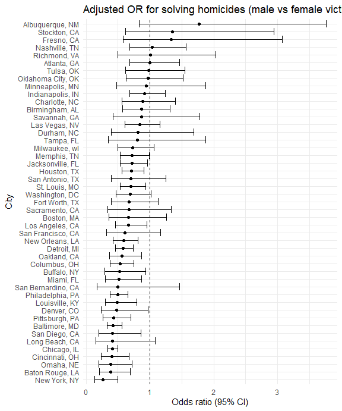

p8105_hw6_qc2385
================
Qixuan Cao
2026-11-24

``` r
library(tidyverse)
library(p8105.datasets)
library(modelr)

set.seed(1)

dir.create("plots", showWarnings = FALSE)
```

## Problem 1

Import and clean the WP homicide data.

``` r
homicide_df =
  read_csv("data/homicide-data.csv", na = c("", "NA", "Unknown")) |>
  mutate(
    city_state = str_c(city, ", ", state),
    resolved = as.numeric(disposition == "Closed by arrest"),
    victim_age = as.numeric(victim_age)
  ) |>
  filter(
    !(city_state %in% c("Dallas, TX", "Phoenix, AZ", "Kansas City, MO", "Tulsa, AL")),
    victim_race %in% c("White", "Black")
  ) |>
  mutate(victim_race = fct_relevel(victim_race, "White")) |>
  select(city_state, resolved, victim_age, victim_race, victim_sex)
```

    ## Rows: 52179 Columns: 12
    ## ── Column specification ────────────────────────────────────────────────────────
    ## Delimiter: ","
    ## chr (8): uid, victim_last, victim_first, victim_race, victim_sex, city, stat...
    ## dbl (4): reported_date, victim_age, lat, lon
    ## 
    ## ℹ Use `spec()` to retrieve the full column specification for this data.
    ## ℹ Specify the column types or set `show_col_types = FALSE` to quiet this message.

The cleaned dataset has 39693 homicides in 47 cities. Key variables are
`city_state`, `resolved` (1 = closed by arrest), `victim_age`,
`victim_race` (White / Black) and `victim_sex`.

Fit the logistic regression for Baltimore.

``` r
baltimore_fit =
  homicide_df |>
  filter(city_state == "Baltimore, MD") |>
  glm(resolved ~ victim_age + victim_sex + victim_race, data = _, family = binomial())

baltimore_or =
  baltimore_fit |>
  broom::tidy() |>
  filter(term == "victim_sexMale") |>
  mutate(
    OR = exp(estimate),
    ci_lower = exp(estimate - 1.96 * std.error),
    ci_upper = exp(estimate + 1.96 * std.error)
  ) |>
  select(term, OR, ci_lower, ci_upper, p.value)

baltimore_or |>
  knitr::kable(digits = 3)
```

| term           |    OR | ci_lower | ci_upper | p.value |
|:---------------|------:|---------:|---------:|--------:|
| victim_sexMale | 0.426 |    0.325 |    0.558 |       0 |

**Sex and solving homicides in Baltimore:**

OR = 0.426, 95% CI: (0.325, 0.558), p \< 0.001.

Therefore, keeping age and race fixed, homicides with male victims have
lower odds of being solved than those with female victims.

Now fit the model for each city.

``` r
city_or_df =
  homicide_df |>
  nest(data = -city_state) |>
  mutate(
    fits = map(data, \(df) glm(resolved ~ victim_age + victim_sex + victim_race, data = df, family = binomial())),
    results = map(fits, broom::tidy)
  ) |>
  select(city_state, results) |>
  unnest(results) |>
  filter(term == "victim_sexMale") |>
  mutate(
    OR = exp(estimate),
    ci_lower = exp(estimate - 1.96 * std.error),
    ci_upper = exp(estimate + 1.96 * std.error)
  ) |>
  select(city_state, OR, ci_lower, ci_upper)

city_or_df |>
  knitr::kable(digits = 3)
```

| city_state         |    OR | ci_lower | ci_upper |
|:-------------------|------:|---------:|---------:|
| Albuquerque, NM    | 1.767 |    0.831 |    3.761 |
| Atlanta, GA        | 1.000 |    0.684 |    1.463 |
| Baltimore, MD      | 0.426 |    0.325 |    0.558 |
| Baton Rouge, LA    | 0.381 |    0.209 |    0.695 |
| Birmingham, AL     | 0.870 |    0.574 |    1.318 |
| Boston, MA         | 0.667 |    0.354 |    1.260 |
| Buffalo, NY        | 0.521 |    0.290 |    0.935 |
| Charlotte, NC      | 0.884 |    0.557 |    1.403 |
| Chicago, IL        | 0.410 |    0.336 |    0.501 |
| Cincinnati, OH     | 0.400 |    0.236 |    0.677 |
| Columbus, OH       | 0.532 |    0.378 |    0.750 |
| Denver, CO         | 0.479 |    0.236 |    0.971 |
| Detroit, MI        | 0.582 |    0.462 |    0.734 |
| Durham, NC         | 0.812 |    0.392 |    1.683 |
| Fort Worth, TX     | 0.669 |    0.397 |    1.127 |
| Fresno, CA         | 1.335 |    0.580 |    3.071 |
| Houston, TX        | 0.711 |    0.558 |    0.907 |
| Indianapolis, IN   | 0.919 |    0.679 |    1.242 |
| Jacksonville, FL   | 0.720 |    0.537 |    0.966 |
| Las Vegas, NV      | 0.837 |    0.608 |    1.154 |
| Long Beach, CA     | 0.410 |    0.156 |    1.082 |
| Los Angeles, CA    | 0.662 |    0.458 |    0.956 |
| Louisville, KY     | 0.491 |    0.305 |    0.790 |
| Memphis, TN        | 0.723 |    0.529 |    0.988 |
| Miami, FL          | 0.515 |    0.304 |    0.872 |
| Milwaukee, wI      | 0.727 |    0.499 |    1.060 |
| Minneapolis, MN    | 0.947 |    0.478 |    1.875 |
| Nashville, TN      | 1.034 |    0.685 |    1.562 |
| New Orleans, LA    | 0.585 |    0.422 |    0.811 |
| New York, NY       | 0.262 |    0.138 |    0.499 |
| Oakland, CA        | 0.563 |    0.365 |    0.868 |
| Oklahoma City, OK  | 0.974 |    0.624 |    1.520 |
| Omaha, NE          | 0.382 |    0.203 |    0.721 |
| Philadelphia, PA   | 0.496 |    0.378 |    0.652 |
| Pittsburgh, PA     | 0.431 |    0.265 |    0.700 |
| Richmond, VA       | 1.006 |    0.498 |    2.033 |
| San Antonio, TX    | 0.705 |    0.398 |    1.249 |
| Sacramento, CA     | 0.669 |    0.335 |    1.337 |
| Savannah, GA       | 0.867 |    0.422 |    1.780 |
| San Bernardino, CA | 0.500 |    0.171 |    1.462 |
| San Diego, CA      | 0.413 |    0.200 |    0.855 |
| San Francisco, CA  | 0.608 |    0.317 |    1.165 |
| St. Louis, MO      | 0.703 |    0.530 |    0.932 |
| Stockton, CA       | 1.352 |    0.621 |    2.942 |
| Tampa, FL          | 0.808 |    0.348 |    1.876 |
| Tulsa, OK          | 0.976 |    0.614 |    1.552 |
| Washington, DC     | 0.691 |    0.469 |    1.018 |

Plot the ORs and CIs.

``` r
city_or_plot =
  city_or_df |>
  mutate(city_state = fct_reorder(city_state, OR)) |>
  ggplot(aes(x = city_state, y = OR)) +
  geom_point() +
  geom_errorbar(aes(ymin = ci_lower, ymax = ci_upper)) +
  geom_hline(yintercept = 1, linetype = "dashed") +
  coord_flip() +
  labs(
    title = "Adjusted OR for solving homicides (male vs female victims)",
    x = "City",
    y = "Odds ratio (95% CI)"
  )

city_or_plot
```



``` r
ggsave("plots/city_or_plot.png", city_or_plot, width = 8, height = 10)
```

Most cities have OR below 1, so homicides with male victims are
generally less likely to be solved than those with female victims. New
York has the lowest OR (0.262), while Albuquerque has the highest
(1.767). Many CIs cross 1, and cities with high ORs (e.g. Albuquerque,
Stockton, Fresno) have wide CIs, likely due to small samples.
