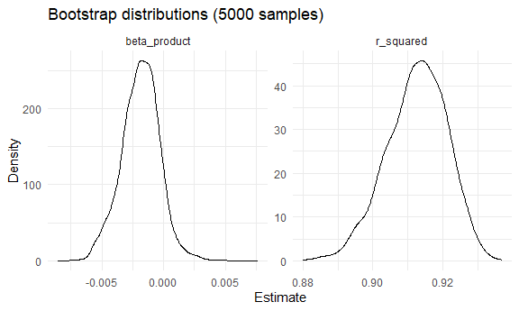
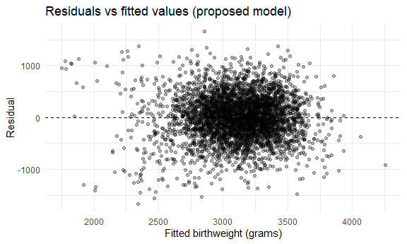
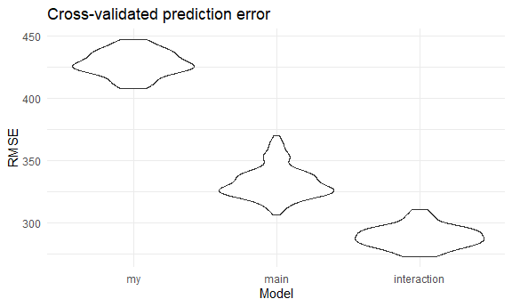

p8105_hw6_qc2385
================
Qixuan Cao
2026-11-25

``` r
library(tidyverse)
library(p8105.datasets)
library(modelr)

set.seed(1)

dir.create("plots", showWarnings = FALSE)
```

## Problem 1

Import and clean the WP homicide data.

``` r
homicide_df =
  read_csv("data/homicide-data.csv", na = c("", "NA", "Unknown")) |>
  mutate(
    city_state = str_c(city, ", ", state),
    resolved = as.numeric(disposition == "Closed by arrest"),
    victim_age = as.numeric(victim_age)
  ) |>
  filter(
    !(city_state %in% c("Dallas, TX", "Phoenix, AZ", "Kansas City, MO", "Tulsa, AL")),
    victim_race %in% c("White", "Black")
  ) |>
  mutate(victim_race = fct_relevel(victim_race, "White")) |>
  select(city_state, resolved, victim_age, victim_race, victim_sex)
```

    ## Rows: 52179 Columns: 12
    ## ── Column specification ────────────────────────────────────────────────────────
    ## Delimiter: ","
    ## chr (8): uid, victim_last, victim_first, victim_race, victim_sex, city, stat...
    ## dbl (4): reported_date, victim_age, lat, lon
    ## 
    ## ℹ Use `spec()` to retrieve the full column specification for this data.
    ## ℹ Specify the column types or set `show_col_types = FALSE` to quiet this message.

The cleaned dataset has 39693 homicides in 47 cities. Key variables are
`city_state`, `resolved` (1 = closed by arrest), `victim_age`,
`victim_race` (White / Black) and `victim_sex`.

Fit the logistic regression for Baltimore.

``` r
baltimore_fit =
  homicide_df |>
  filter(city_state == "Baltimore, MD") |>
  glm(resolved ~ victim_age + victim_sex + victim_race, data = _, family = binomial())

baltimore_or =
  baltimore_fit |>
  broom::tidy() |>
  filter(term == "victim_sexMale") |>
  mutate(
    OR = exp(estimate),
    ci_lower = exp(estimate - 1.96 * std.error),
    ci_upper = exp(estimate + 1.96 * std.error)
  ) |>
  select(term, OR, ci_lower, ci_upper, p.value)

baltimore_or |>
  knitr::kable(digits = 3)
```

| term           |    OR | ci_lower | ci_upper | p.value |
|:---------------|------:|---------:|---------:|--------:|
| victim_sexMale | 0.426 |    0.325 |    0.558 |       0 |

**Sex and solving homicides in Baltimore:**

OR = 0.426, 95% CI: (0.325, 0.558), p \< 0.001.

Therefore, keeping age and race fixed, homicides with male victims have
lower odds of being solved than those with female victims.

Now fit the model for each city.

``` r
city_or_df =
  homicide_df |>
  nest(data = -city_state) |>
  mutate(
    fits = map(data, \(df) glm(resolved ~ victim_age + victim_sex + victim_race, data = df, family = binomial())),
    results = map(fits, broom::tidy)
  ) |>
  select(city_state, results) |>
  unnest(results) |>
  filter(term == "victim_sexMale") |>
  mutate(
    OR = exp(estimate),
    ci_lower = exp(estimate - 1.96 * std.error),
    ci_upper = exp(estimate + 1.96 * std.error)
  ) |>
  select(city_state, OR, ci_lower, ci_upper)

city_or_df |>
  knitr::kable(digits = 3)
```

| city_state         |    OR | ci_lower | ci_upper |
|:-------------------|------:|---------:|---------:|
| Albuquerque, NM    | 1.767 |    0.831 |    3.761 |
| Atlanta, GA        | 1.000 |    0.684 |    1.463 |
| Baltimore, MD      | 0.426 |    0.325 |    0.558 |
| Baton Rouge, LA    | 0.381 |    0.209 |    0.695 |
| Birmingham, AL     | 0.870 |    0.574 |    1.318 |
| Boston, MA         | 0.667 |    0.354 |    1.260 |
| Buffalo, NY        | 0.521 |    0.290 |    0.935 |
| Charlotte, NC      | 0.884 |    0.557 |    1.403 |
| Chicago, IL        | 0.410 |    0.336 |    0.501 |
| Cincinnati, OH     | 0.400 |    0.236 |    0.677 |
| Columbus, OH       | 0.532 |    0.378 |    0.750 |
| Denver, CO         | 0.479 |    0.236 |    0.971 |
| Detroit, MI        | 0.582 |    0.462 |    0.734 |
| Durham, NC         | 0.812 |    0.392 |    1.683 |
| Fort Worth, TX     | 0.669 |    0.397 |    1.127 |
| Fresno, CA         | 1.335 |    0.580 |    3.071 |
| Houston, TX        | 0.711 |    0.558 |    0.907 |
| Indianapolis, IN   | 0.919 |    0.679 |    1.242 |
| Jacksonville, FL   | 0.720 |    0.537 |    0.966 |
| Las Vegas, NV      | 0.837 |    0.608 |    1.154 |
| Long Beach, CA     | 0.410 |    0.156 |    1.082 |
| Los Angeles, CA    | 0.662 |    0.458 |    0.956 |
| Louisville, KY     | 0.491 |    0.305 |    0.790 |
| Memphis, TN        | 0.723 |    0.529 |    0.988 |
| Miami, FL          | 0.515 |    0.304 |    0.872 |
| Milwaukee, wI      | 0.727 |    0.499 |    1.060 |
| Minneapolis, MN    | 0.947 |    0.478 |    1.875 |
| Nashville, TN      | 1.034 |    0.685 |    1.562 |
| New Orleans, LA    | 0.585 |    0.422 |    0.811 |
| New York, NY       | 0.262 |    0.138 |    0.499 |
| Oakland, CA        | 0.563 |    0.365 |    0.868 |
| Oklahoma City, OK  | 0.974 |    0.624 |    1.520 |
| Omaha, NE          | 0.382 |    0.203 |    0.721 |
| Philadelphia, PA   | 0.496 |    0.378 |    0.652 |
| Pittsburgh, PA     | 0.431 |    0.265 |    0.700 |
| Richmond, VA       | 1.006 |    0.498 |    2.033 |
| San Antonio, TX    | 0.705 |    0.398 |    1.249 |
| Sacramento, CA     | 0.669 |    0.335 |    1.337 |
| Savannah, GA       | 0.867 |    0.422 |    1.780 |
| San Bernardino, CA | 0.500 |    0.171 |    1.462 |
| San Diego, CA      | 0.413 |    0.200 |    0.855 |
| San Francisco, CA  | 0.608 |    0.317 |    1.165 |
| St. Louis, MO      | 0.703 |    0.530 |    0.932 |
| Stockton, CA       | 1.352 |    0.621 |    2.942 |
| Tampa, FL          | 0.808 |    0.348 |    1.876 |
| Tulsa, OK          | 0.976 |    0.614 |    1.552 |
| Washington, DC     | 0.691 |    0.469 |    1.018 |

Plot the ORs and CIs.

``` r
city_or_plot =
  city_or_df |>
  mutate(city_state = fct_reorder(city_state, OR)) |>
  ggplot(aes(x = city_state, y = OR)) +
  geom_point() +
  geom_errorbar(aes(ymin = ci_lower, ymax = ci_upper)) +
  geom_hline(yintercept = 1, linetype = "dashed") +
  coord_flip() +
  labs(
    title = "Adjusted OR for solving homicides \n (male vs female victims)",
    x = "City",
    y = "Odds ratio (95% CI)"
  )

city_or_plot
```


``` r
ggsave("plots/city_or_plot.png", city_or_plot, width = 8, height = 10)
```

Most cities have OR below 1, so homicides with male victims are
generally less likely to be solved than those with female victims. New
York has the lowest OR (0.262), while Albuquerque has the highest
(1.767). Many CIs cross 1, and cities with high ORs (e.g. Albuquerque,
Stockton, Fresno) have wide CIs, likely due to small samples.

## Problem 2

Load the Central Park weather data.

``` r
data("weather_df")

weather_df =
  weather_df |>
  filter(name == "CentralPark_NY") |>
  drop_na(tmax, tmin, prcp)
```

The data have 730 daily observations from Central Park, including
`date`, `prcp`, `tmax` and `tmin`.

Draw 5000 bootstrap samples, fit the model, and get r^2 and the product
of the two slopes.

``` r
boot_df =
  weather_df |>
  modelr::bootstrap(n = 5000) |>
  mutate(
    fits = map(strap, \(df) lm(tmax ~ tmin + prcp, data = df)),
    glance_res = map(fits, broom::glance),
    tidy_res = map(fits, broom::tidy),
    r_squared = map_dbl(glance_res, \(df) pull(df, r.squared)),
    beta_product = map_dbl(
      tidy_res,
      \(df) df |> filter(term != "(Intercept)") |> pull(estimate) |> prod()
    )
  ) |>
  select(.id, r_squared, beta_product)
```

Plot the distributions.

``` r
boot_plot =
  boot_df |>
  pivot_longer(
    r_squared:beta_product,
    names_to = "quantity",
    values_to = "estimate"
  ) |>
  ggplot(aes(x = estimate)) +
  geom_density() +
  facet_wrap(~quantity, scales = "free") +
  labs(
    title = "Bootstrap distributions (5000 samples)",
    x = "Estimate",
    y = "Density"
  )

boot_plot
```



``` r
ggsave("plots/boot_plot.png", boot_plot, width = 8, height = 5)
```

The distribution of r^2 is unimodal and slightly left-skewed, peaking
around 0.915, so tmin and prcp explain most of the variation in tmax.
The distribution of the slope product is also unimodal, peaking around
-0.002 with a slight right tail, because the prcp slope is very small
and close to 0.

95% CIs from the 2.5% and 97.5% quantiles:

``` r
boot_df |>
  pivot_longer(
    r_squared:beta_product,
    names_to = "quantity",
    values_to = "estimate"
  ) |>
  group_by(quantity) |>
  summarize(
    ci_lower = quantile(estimate, 0.025),
    ci_upper = quantile(estimate, 0.975)
  ) |>
  knitr::kable(digits = 4)
```

| quantity     | ci_lower | ci_upper |
|:-------------|---------:|---------:|
| beta_product |  -0.0051 |   0.0012 |
| r_squared    |   0.8942 |   0.9277 |

The 95% CI for r^2 is (0.894, 0.928), and the 95% CI for the slope
product is (-0.0051, 0.0012). Therefore, the model fits the data well,
and the product of the two slopes is not clearly different from 0, since
its CI includes 0.

## Problem 3

Load and clean the birthweight data.

``` r
bwt_df =
  read_csv("data/birthweight.csv") |>
  mutate(
    babysex = factor(babysex, levels = c(1, 2), labels = c("male", "female")),
    frace = factor(
      frace,
      levels = c(1, 2, 3, 4, 8, 9),
      labels = c("White", "Black", "Asian", "Puerto Rican", "Other", "Unknown")),
    mrace = factor(
      mrace,
      levels = c(1, 2, 3, 4, 8),
      labels = c("White", "Black", "Asian", "Puerto Rican", "Other")),
    malform = factor(malform, levels = c(0, 1), labels = c("absent", "present"))
  )
```

    ## Rows: 4342 Columns: 20
    ## ── Column specification ────────────────────────────────────────────────────────
    ## Delimiter: ","
    ## dbl (20): babysex, bhead, blength, bwt, delwt, fincome, frace, gaweeks, malf...
    ## 
    ## ℹ Use `spec()` to retrieve the full column specification for this data.
    ## ℹ Specify the column types or set `show_col_types = FALSE` to quiet this message.

Check missing data.

``` r
bwt_df |>
  summarize(across(everything(), \(x) sum(is.na(x)))) |>
  pivot_longer(everything(), names_to = "variable", values_to = "n_missing") |>
  filter(n_missing > 0)
```

    ## # A tibble: 0 × 2
    ## # ℹ 2 variables: variable <chr>, n_missing <int>

The data have 4342 children and 20 variables, with no missing values.
`babysex`, `frace`, `mrace` and `malform` are converted to factors; the
rest are numeric. `pnumlbw` and `pnumsga` are 0 for all children, almost
all mothers have `parity` = 0 (only 3 do not), and no mother is in the
“Other” race group, so these variables carry little or no information.

**Proposed model.** I chose predictors based on a hypothesized
structure: factors known before delivery that affect fetal growth. These
are gestational age (`gaweeks`), baby’s sex (`babysex`), mother’s race
(`mrace`), smoking (`smoken`), pre-pregnancy BMI (`ppbmi`), and weight
gain (`wtgain`). I did not include head circumference or length, since
these are measured at birth along with weight. Father’s race is left out
because it is highly correlated with mother’s race, and parity is left
out because it has almost no variation.

``` r
my_fit = lm(bwt ~ gaweeks + babysex + mrace + smoken + ppbmi + wtgain, data = bwt_df)

my_fit |>
  broom::tidy() |>
  knitr::kable(digits = 3)
```

| term              | estimate | std.error | statistic | p.value |
|:------------------|---------:|----------:|----------:|--------:|
| (Intercept)       |  564.422 |    93.956 |     6.007 |   0.000 |
| gaweeks           |   54.104 |     2.121 |    25.506 |   0.000 |
| babysexfemale     |  -85.144 |    13.008 |    -6.545 |   0.000 |
| mraceBlack        | -297.676 |    14.157 |   -21.027 |   0.000 |
| mraceAsian        | -126.737 |    66.254 |    -1.913 |   0.056 |
| mracePuerto Rican | -186.739 |    29.181 |    -6.399 |   0.000 |
| smoken            |  -11.552 |     0.907 |   -12.739 |   0.000 |
| ppbmi             |   20.056 |     2.067 |     9.702 |   0.000 |
| wtgain            |    9.787 |     0.604 |    16.194 |   0.000 |

Residuals vs fitted values:

``` r
resid_plot =
  bwt_df |>
  modelr::add_predictions(my_fit) |>
  modelr::add_residuals(my_fit) |>
  ggplot(aes(x = pred, y = resid)) +
  geom_point(alpha = .3) +
  geom_hline(yintercept = 0, linetype = "dashed") +
  labs(
    title = "Residuals vs fitted values (proposed model)",
    x = "Fitted birthweight (grams)",
    y = "Residual"
  )

resid_plot
```



``` r
ggsave("plots/resid_plot.png", resid_plot, width = 8, height = 5)
```

Residuals are mostly centered around 0 with no clear pattern for fitted
values between about 2500 and 3800 grams. At low fitted values (below
about 2500 grams) the residuals are more spread out, suggesting the
model fits less well for small babies.

Compare with the two other models using cross validation.

``` r
cv_df =
  crossv_mc(bwt_df, 100) |>
  mutate(
    train = map(train, as_tibble),
    test = map(test, as_tibble)
  )

cv_df =
  cv_df |>
  mutate(
    my_fit = map(train, \(df) lm(bwt ~ gaweeks + babysex + mrace + smoken + ppbmi + wtgain, data = df)),
    main_fit = map(train, \(df) lm(bwt ~ blength + gaweeks, data = df)),
    interaction_fit = map(train, \(df) lm(bwt ~ bhead * blength * babysex, data = df))
  ) |>
  mutate(
    rmse_my = map2_dbl(my_fit, test, rmse),
    rmse_main = map2_dbl(main_fit, test, rmse),
    rmse_interaction = map2_dbl(interaction_fit, test, rmse)
  )
```

``` r
cv_plot =
  cv_df |>
  select(starts_with("rmse_")) |>
  pivot_longer(
    everything(),
    names_to = "model",
    names_prefix = "rmse_",
    values_to = "rmse"
  ) |>
  mutate(model = fct_inorder(model)) |>
  ggplot(aes(x = model, y = rmse)) +
  geom_violin() +
  labs(
    title = "Cross-validated prediction error",
    x = "Model",
    y = "RMSE"
  )

cv_plot
```



``` r
ggsave("plots/cv_plot.png", cv_plot, width = 8, height = 5)
```

The interaction model (head circumference, length, sex and all
interactions) has the lowest RMSE (about 290), followed by the main
effects model (length and gestational age, about 330). My proposed model
has the highest RMSE (about 425) because it does not use body
measurements at birth, which are strongly related to birthweight.
Therefore, for prediction, the interaction model performs best.
